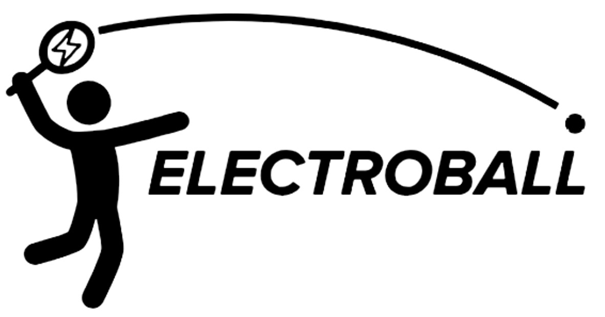

# ElectroBall

  

A 3D tennis game made in unity co-developed with classmate Rui Araújo as the final project for the completion of the course "Technician in Management and Programming of Computer Systems"

## Development

Software used to develop ElectroBall:
- Unity 2019.1.9
- MagicaVoxel
- Mixamo
- Adobe Photoshop 2019

## Showcase

